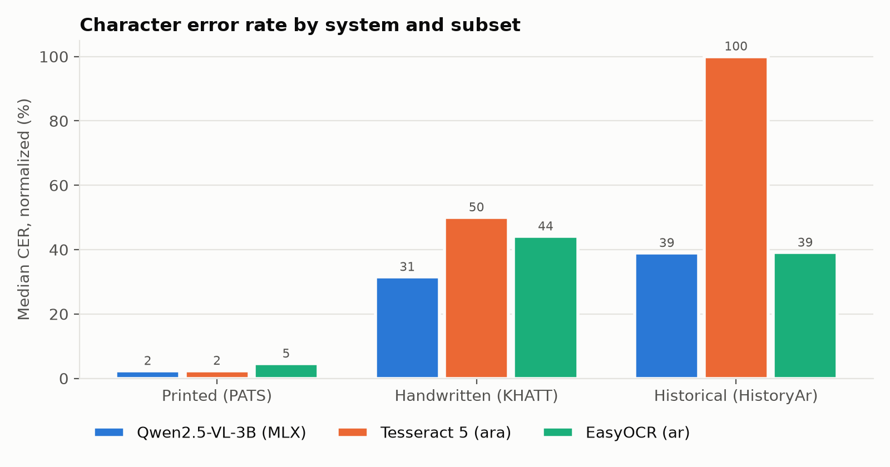
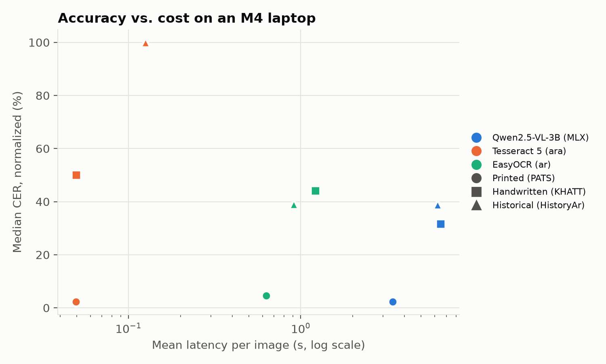
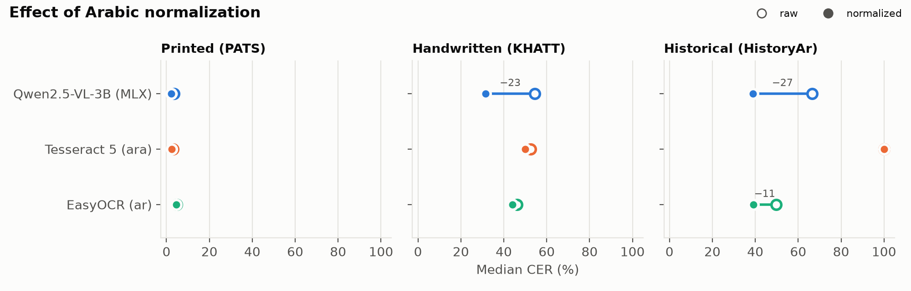
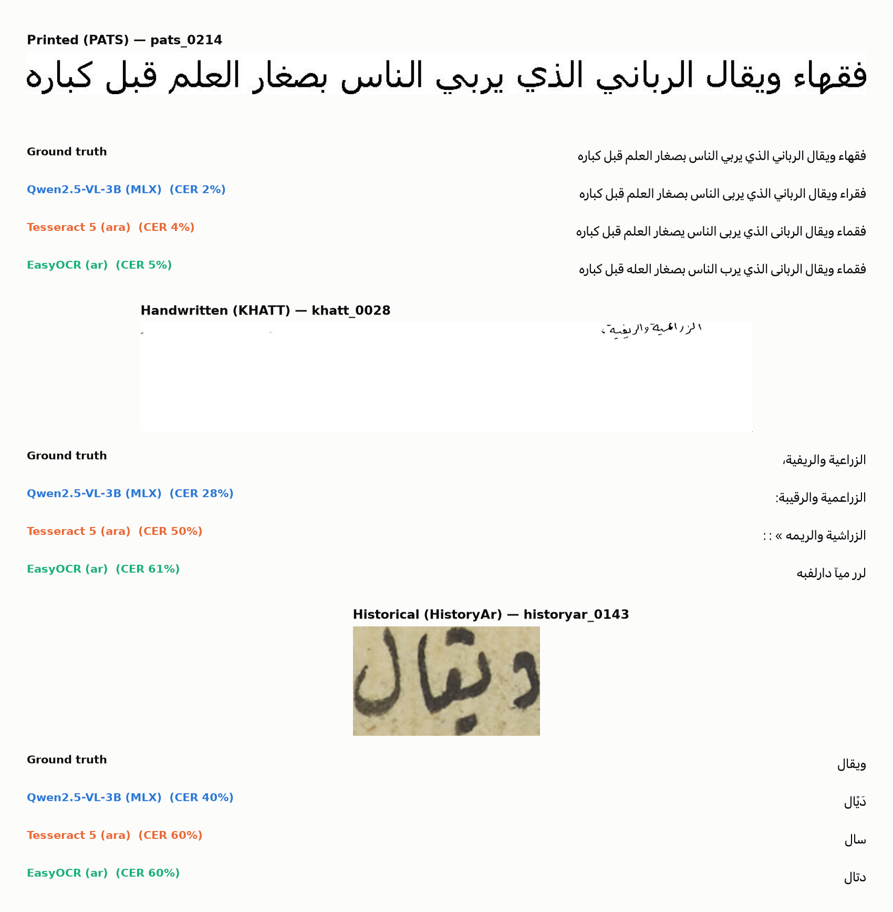

# Arabic OCR Mini-Benchmark: small open VLMs vs. classic OCR

**Question.** How does a small open VLM that runs on a laptop (Qwen2.5-VL-3B, on an Apple M4 via MLX) compare with classic OCR engines (Tesseract 5, EasyOCR) on printed, handwritten and historical Arabic, and which Arabic-specific errors does each make?

<!-- HEADLINE:START -->
**On 300 KITAB-Bench line images, Qwen2.5-VL-3B running locally on an M4 via MLX matches Tesseract on printed Arabic (2.3% median CER for both). It is best on handwriting (31.5% vs. 44.1% for EasyOCR and 50.0% for Tesseract) and ties EasyOCR on historical manuscripts (38.9% vs. 39.0%), while Tesseract fails outright there (51% empty outputs). The VLM's failures are different in kind: it writes fluent but wrong words, adds diacritics that are not in the image, and on 10% of manuscript lines it hallucinates, often religious formulae, until the token cap. Arabic-specific normalization cuts its median CER by 23–27 points on handwritten and historical text, and it is that normalization that turns Qwen from worst to best on handwriting.**
<!-- HEADLINE:END -->

## Why this is interesting

Arabic OCR is harder than English OCR: the script is cursive, right to left, letters change shape with position, many letters differ only by dots (ب ت ث ن ي), and real text mixes optional diacritics, elongation (tatweel) and spelling variants. [KITAB-Bench](https://arxiv.org/abs/2502.14949) showed that large VLMs beat classic engines by a wide margin, but its headline numbers are for large or closed models. This repo asks the cheaper question: what do you get from a ~3B open model on a 16 GB laptop?

## Setup

| | |
|---|---|
| **Data** | 3 line-level KITAB-Bench subsets, 100 samples each (seed 42): [PATS](https://huggingface.co/datasets/ahmedheakl/arocrbench_patsocr) (printed), [KHATT](https://huggingface.co/datasets/ahmedheakl/arocrbench_khatt) (handwritten), [HistoryAr](https://huggingface.co/datasets/ahmedheakl/arocrbench_historyar) (historical manuscripts) |
| **Systems** | `mlx-community/Qwen2.5-VL-3B-Instruct-bf16` (greedy, ≤256 new tokens, one fixed prompt) · Tesseract 5.5 `-l ara --psm 7` · EasyOCR 1.7 `ar` (CPU) |
| **Metrics** | CER / WER ([jiwer](https://github.com/jitsi/jiwer)) in raw and normalized mode, mean **and median**, hallucination rate (prediction > 1.5× reference length), empty-output rate, latency per image, peak memory |
| **Hardware** | MacBook Pro 14" (M4, 2024), 16 GB unified memory |

Prompt: *"Transcribe all Arabic text in this image exactly as written. Output only the text."*

### Arabic normalization

Scores are reported twice. **Raw** only trims whitespace. **Normalized** removes variation that Arabic references themselves are inconsistent about, so what remains is real misrecognition:

- remove diacritics (tashkeel U+064B–U+0652, plus dagger alef U+0670)
- remove tatweel `ـ`
- unify alef forms `أ إ آ ٱ → ا` and map alef maqsura `ى → ي`
- map Persian-style and dotless manuscript letter forms to standard Arabic: `ی → ي`, `ک → ك`, `ڡ → ف`, `ں → ن` (19 of 100 HistoryAr references use them; no OCR system emits dotless forms)
- Arabic-Indic and Persian digits → `0-9`
- NFKC (folds presentation-form glyphs such as `ﻻ` back to `لا`), strip bidi control marks, collapse whitespace

See [`src/normalize.py`](src/normalize.py) and its tests in [`tests/test_normalize.py`](tests/test_normalize.py).

### Why medians

A VLM that loops can emit hundreds of characters for a 60-character line, giving a CER far above 1.0 on one sample. That single sample can move a 100-sample mean more than all the others combined. Medians, plus a separate hallucination rate, keep the typical case and the failure case apart.

## Results

<!-- RESULTS:START -->
**Median CER (normalized), lower is better**

| System | Printed (PATS) | Handwritten (KHATT) | Historical (HistoryAr) |
|---|---:|---:|---:|
| Qwen2.5-VL-3B (MLX) | 2.3% | 31.5% | 38.9% |
| Tesseract 5 (ara) | 2.3% | 50.0% | 100.0% |
| EasyOCR (ar) | 4.5% | 44.1% | 39.0% |

**Full results** (CER/WER as %, n = samples scored)

| System | Subset | n | CER raw (median / mean) | CER norm (median / mean) | WER norm (median / mean) | Halluc. rate | Empty output | Latency s/img (mean) | Peak mem GB |
|---|---|---:|---:|---:|---:|---:|---:|---:|---:|
| Qwen2.5-VL-3B (MLX) | Printed (PATS) | 100 | 3.5% / 12.2% | 2.3% / 7.2% | 7.7% / 12.3% | 1.0% | 0.0% | 3.42 | 8.25 |
| Tesseract 5 (ara) | Printed (PATS) | 100 | 3.2% / 11.6% | 2.3% / 11.0% | 9.2% / 25.8% | 0.0% | 6.0% | 0.05 | 0.06 |
| EasyOCR (ar) | Printed (PATS) | 100 | 4.8% / 7.1% | 4.5% / 6.2% | 17.2% / 23.1% | 0.0% | 0.0% | 0.63 | 6.61 |
| Qwen2.5-VL-3B (MLX) | Handwritten (KHATT) | 100 | 54.5% / 67.2% | 31.5% / 45.0% | 78.4% / 82.3% | 3.0% | 0.0% | 6.52 | 8.25 |
| Tesseract 5 (ara) | Handwritten (KHATT) | 100 | 52.5% / 60.1% | 50.0% / 58.4% | 100.0% / 106.3% | 0.0% | 23.0% | 0.05 | 0.06 |
| EasyOCR (ar) | Handwritten (KHATT) | 100 | 46.1% / 45.4% | 44.1% / 43.5% | 100.0% / 104.8% | 0.0% | 0.0% | 1.22 | 6.61 |
| Qwen2.5-VL-3B (MLX) | Historical (HistoryAr) | 100 | 66.4% / 185.0% | 38.9% / 157.5% | 86.2% / 187.3% | 10.0% | 0.0% | 6.23 | 8.25 |
| Tesseract 5 (ara) | Historical (HistoryAr) | 100 | 100.0% / 80.8% | 100.0% / 79.5% | 100.0% / 102.4% | 0.0% | 51.0% | 0.13 | 0.06 |
| EasyOCR (ar) | Historical (HistoryAr) | 100 | 49.7% / 54.0% | 39.0% / 47.0% | 100.0% / 95.5% | 0.0% | 9.0% | 0.91 | 6.61 |
<!-- RESULTS:END -->

Peak memory is the MLX Metal peak for Qwen (bf16 weights) and the peak process RSS for the classic engines (EasyOCR runs on CPU). Hallucination rate is the share of predictions more than 1.5× longer than the reference.







Normalization barely changes the classic engines' scores, but it moves Qwen by 23–27 points on handwritten and historical text. Two sources account for that gap. Qwen adds tashkeel the references lack: 67 of 100 KHATT outputs have diacritics, but only 6 of the 100 references do. And manuscript references use spelling variants (dotless and Persian letter forms). Under raw scoring, Qwen ranks **last** on handwriting (54.5%); normalized, it ranks **first** (31.5%). A raw-only benchmark would have reported the opposite conclusion.

**Example outputs.** For each subset, the sample whose mean CER across systems is closest to that subset's median (representative, not cherry-picked):



## Error analysis

**Catastrophic failures**, counted over every prediction:

<!-- FAILURES:START -->
Counted over all 300 predictions per system.

| Failure mode | Qwen2.5-VL-3B (MLX) | Tesseract 5 (ara) | EasyOCR (ar) |
|---|---:|---:|---:|
| Empty output | 0 | 80 | 9 |
| Output > 1.5x reference length | 14 | 0 | 0 |
| Repetition loop (a 3-gram repeated 3+ times) | 6 | 0 | 0 |
| Mostly non-Arabic script (e.g. Chinese, Latin) | 2 | 0 | 0 |
| Religious formula not in the image (الله لا إله إلا هو / الحمد لله) | 12 | 0 | 0 |
<!-- FAILURES:END -->

**Arabic-specific error types** on partial misreadings. The worst-k list is all empty or runaway outputs, so it tells you *that* a system failed, not *how* it misreads Arabic:

<!-- ERRORS:START -->
15 randomly sampled predictions per system (seed 42) with 5% < CER ≤ 60%, i.e. partial misreadings rather than total failures; hand-reviewed labels (`results/error_labels.csv`). A sample can carry several labels.

| Error type | Qwen2.5-VL-3B (MLX) | Tesseract 5 (ara) | EasyOCR (ar) |
|---|---:|---:|---:|
| Confused dotted letters (ب/ت/ث, ج/ح/خ, ...) | 5 | 9 | 8 |
| Other letter-shape confusion (e.g. ع/ه, ر/و, م/ه) | 2 | 13 | 6 |
| Whole-word substitution (a real but wrong word) | 12 | 0 | 0 |
| Letter joining / word segmentation (merged or split words) | 5 | 5 | 9 |
| Digit errors | 1 | 0 | 4 |
| Word order or right-to-left reversal | 1 | 0 | 0 |
| Missing words | 1 | 2 | 6 |
| Hallucinated / repeated text | 1 | 0 | 0 |
| Inserted words or punctuation | 2 | 4 | 3 |
<!-- ERRORS:END -->

Full labeled samples and notes: [`results/error_analysis.md`](results/error_analysis.md).

### What the errors say

- **Qwen2.5-VL-3B makes word-level errors (language prior).** In 12 of 15 sampled errors it writes a real Arabic word that is not in the image (ابتدات→البدلات, المريخ→المرجح). It turns KHATT's nonsense test words into real ones, and it finishes formulae that are cut off (adds وسلم after صلى الله عليه). On illegible manuscript lines it falls back on الله لا إله إلا هو / الحمد لله (12 of 100 HistoryAr lines). Its output stays fluent, so these errors are hard to catch downstream.
- **Tesseract makes character-level errors.** Shape and dotted-letter confusions dominate: ت→ن, ف→ق, ه→ة, ي→ب, the pairs that share a rasm and differ only in dots. When it cannot read a line it returns nothing, which happens for 80 of 300 lines, including 6% of clean printed lines.
- **EasyOCR makes segmentation errors.** It merges and splits words (وبيلانالجزءالثالت is four words glued together) and injects Latin digits and symbols.
- **Dotted-letter confusion is shared by all three systems** (5, 9 and 8 of 15). It is the one Arabic-specific error none of them solves.

### Cost

Tesseract runs at 0.05 s per line and 65 MB; it is the right tool for clean print and nothing else. EasyOCR takes about 1 s and 6.6 GB on CPU. Qwen takes 3–7 s per line and 8.2 GB of unified memory, 50–130× slower than Tesseract. That buys usable handwriting and manuscript recognition, but it needs a guard against hallucination in any real pipeline: flag outputs much longer than the detected text region, and treat religious formulae on non-religious pages as suspect.

## Reproduce

```bash
brew install tesseract tesseract-lang          # Tesseract + Arabic traineddata
python -m venv .venv && source .venv/bin/activate
pip install -r requirements.txt
python run.py --config config.yaml             # data -> predictions -> metrics -> figures
python run.py --limit 5                        # smoke test: 5 samples per subset
python run.py --skip-predict                   # rescore cached predictions only
pytest tests
```

Predictions are cached line by line in `preds/<system>/<subset>.jsonl`, so an interrupted run resumes where it stopped. The predictions are committed, so `python run.py --skip-predict` rebuilds every table and figure without the models. It still downloads the 300 images and references from Hugging Face. Each system runs in its own process so its peak memory is measured in isolation.

```
config.yaml          N, seed, dataset IDs, model IDs, prompt
run.py               one-command pipeline
src/data.py          FR1  sample KITAB-Bench subsets -> data/<subset>/manifest.jsonl
src/runners/         FR2  qwen_vl_mlx.py, tesseract.py, easyocr_runner.py: predict(image) -> {text, latency_s}
src/predict.py            per-system driver with caching + peak-memory capture
src/normalize.py     FR3  Arabic normalization
src/metrics.py       FR4  CER/WER, hallucination + empty flags, aggregates
src/report.py        FR5  summary.csv/.md, figures, README tables
src/errors.py        FR6  worst-k extraction + heuristic Arabic error labels
results/                  summary.csv, per_sample.csv, error_analysis.md, figures/
```

## Limitations

- 100 samples per subset: medians are stable to a few CER points, not to decimals.
- Line-level crops only; no page layout, so detection is not tested.
- Tesseract's page-segmentation mode (`--psm 7`, single line) was chosen on 20 held-out samples per subset that are not in the benchmark sample, not on the test set.
- Some reference transcriptions contain noise (e.g. stray brackets in HistoryAr), which caps achievable CER above zero for every system.

## Future work

- LoRA fine-tuning of Qwen2.5-VL-3B on the weakest subset (historical manuscripts), using the KITAB-Bench training splits, on-device with `mlx-vlm`.
- Larger and Arabic-specialized models (Qwen2.5-VL-7B 4-bit is already a config entry; AIN, Arabic-tuned VLMs).
- Full-benchmark runs and the layout, table and chart tasks of KITAB-Bench.
- Closed-model API baselines for a ceiling.
